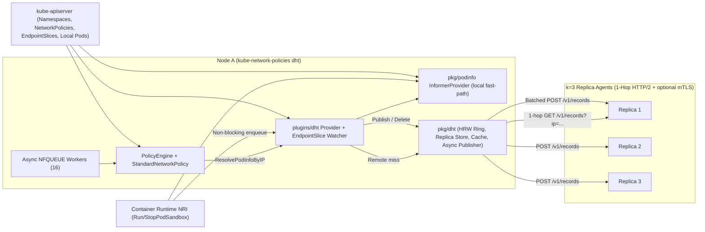
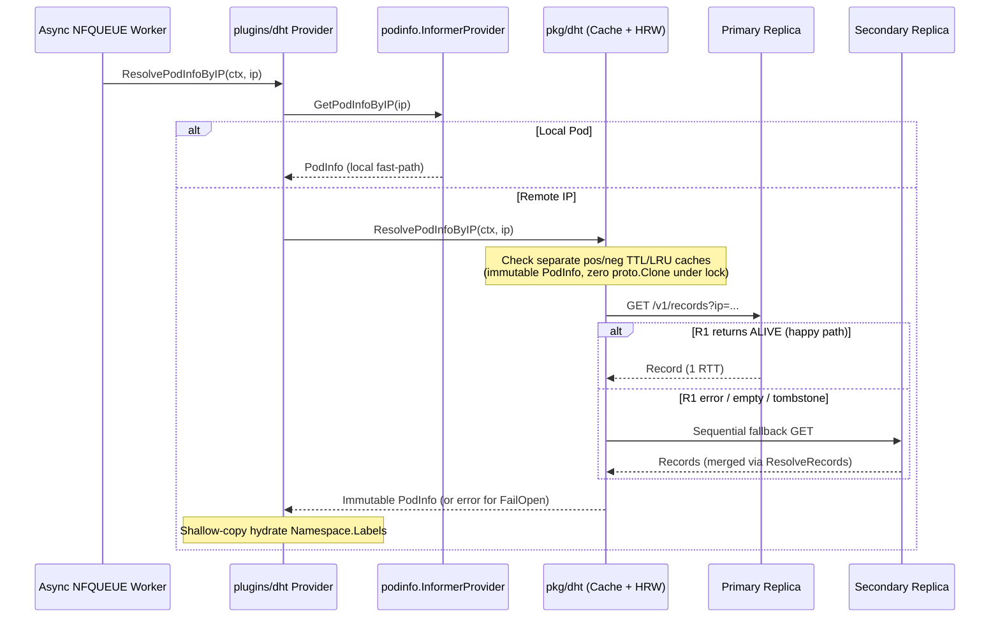

The `dht` flavor removes the cluster-wide `Pod` informer from every node agent without requiring a separate central `kube-ip-tracker` deployment. Each `kube-network-policies` DaemonSet pod tracks only its own local pods and participates in a self-contained **1-hop Rendezvous-Hashing Distributed Hash Table (DHT)** over Go stdlib **HTTP/2** (`h2c` or TLS 1.3 mTLS), using `kube-apiserver` (`EndpointSlice`) as the consistent source of ring membership.

---

## 1. Design Goals

- **Zero global `Pod` watch:** Eliminate $O(\text{nodes} \times \text{pods})$ pod watch fanout from `kube-apiserver`.
- **Self-contained deployment:** Run inside the existing `kube-network-policies` DaemonSet plus one headless `Service`. No central stateful deployment to scale or operate.
- **CNI-agnostic:** Work on every CNI, including CNIs without per-node `PodCIDRs` (such as AWS VPC CNI, Azure dynamic IPAM, and Calico `/32` block borrowing).
- **No split-brain membership:** Reuse `kube-apiserver` (`EndpointSlice`) as the linearizable membership source instead of running a separate gossip consensus protocol.
- **Simplicity and decoupling:** Keep `pkg/dht` pure Go stdlib HTTP/2 with zero Kubernetes or NRI dependencies, put Kubernetes wiring in `plugins/dht` reusing `pkg/podinfo`, and reuse `StandardNetworkPolicy` unchanged so `divertAll` stays `false`.

---

## 2. Architecture and Package Boundaries

### Clean Layering

| Package | Responsibility | Dependencies |
|---|---|---|
| `pkg/dht` | Pure 1-hop Rendezvous Hashing ring, bounded replica store, separate positive/negative TTL/LRU caches, stdlib HTTP/2 server & client, async coalesced publisher | Stdlib, `pkg/api`, `protobuf`, `singleflight`, `lru`, Prometheus (**zero `client-go` / `nri` / `grpc`**) |
| `plugins/dht` | `EndpointSlice` watcher (debounced via `pkg/runner`), `Provider` composing `podinfo.NewInformerProvider` + `pkg/dht.DHT` + local Namespace label hydration | `pkg/dht`, `pkg/podinfo`, `pkg/runner`, `client-go` (**zero `nri`**) |
| `cmd/kube-network-policies/dht` | Composes `pkg/dht`, `plugins/dht`, `pkg/podinfo/nri`, `StandardNetworkPolicy`, and `pkg/cmd` with 6 DHT flags | Wiring only |

### API Server Watch Footprint per Node

| Watch | Scope | Purpose |
|---|---|---|
| `NetworkPolicies` | Cluster-wide | Policy rules (small, low churn) |
| `Namespaces` | Cluster-wide | Namespace labels for `namespaceSelector` (small, low churn) |
| `EndpointSlices` | `kube-system`, filtered to `kubernetes.io/service-name=kube-network-policies-dht` | Consistent DHT ring membership (~1 slice per 100 nodes) |
| `Pods` | Node-scoped (`fieldSelector: spec.nodeName=<node>`) | Local pod label mutations (`kubectl label pod`), `ContainerPorts` (named ports), and `--disable-nri` fallback |

**Zero-cost namespace label edits:** `PodInfo` records stored in the DHT carry only `Namespace.Name` (immutable) and strip `Namespace.Labels`. `plugins/dht.Provider` hydrates `Namespace.Labels` locally via a shallow struct copy (no `proto.Clone`) on every read, so `kubectl label namespace` takes effect immediately with **zero DHT writes**.

---

## 3. Rendezvous Hashing (HRW) Ring Membership

Every agent watches the `EndpointSlice`s of a headless Service (`clusterIP: None`) selecting the DaemonSet pods and builds the exact same immutable **Rendezvous Hashing (Highest Random Weight)** ring (`pkg/dht/ring.go`):

- **1-state simplicity:** Include ready endpoints (`Ready == nil || *Ready`). With replication factor $k = 3$, adding or removing a node always leaves $k - 1 = 2$ warm replicas for affected keys — no separate `Joining`/`Leaving` dual rings, warmup delays, or drain sleeps.
- **No virtual nodes:** Each member pre-hashes `NodeName` once (`SHA-256 -> uint64`), and `Targets(ip, 3)` mixes `hash(ip) ^ nameHash` with SplitMix64 on the stack. At 5,000 nodes, the ring takes ~160 KB (instead of sorting hundreds of thousands of vnodes) and computes top-3 targets in microseconds.
- **Debounced sync:** `plugins/dht.WatchEndpointSlices` coalesces startup bursts across many `EndpointSlice`s via `pkg/runner.BoundedFrequencyRunner`.
- **Safe rolling updates:** Removing a restarting agent from `EndpointSlice` does **not** purge existing replica records owned by that node; healthy workload pods stay reachable through surviving replicas while `RecordTTL` (90 s) expires truly dead nodes naturally.

---

## 4. Wire Protocol, Clock-Skew Safety, and Tombstones

The HTTP/2 transport (`pkg/dht/transport.go`) exposes just two JSON+Protobuf endpoints using Go stdlib `net/http` (prior-knowledge `h2c` in plaintext, or HTTP/2 over TLS 1.3 with mTLS):

- `POST /v1/records` — batched `Put` (up to 256 records, 1 MiB body limit).
- `GET /v1/records?ip=<ip>` — returns all non-expired per-owner records for `ip` (query parameter keeps IPv4 and IPv6 addresses unescaped and `curl`-debuggable).

### Invariants

1. **No blocking callbacks and no sequence inversion:**
   Informer and NRI handlers only update in-memory state and signal a single async publisher goroutine (`publishLoop`). That single goroutine batches dirty IPs per replica and is the sole allocator of monotonic `Seq` numbers, so concurrent lease refreshes and deletes can never invert `Seq` order.
2. **No cross-node wall-clock comparisons:**
   Records carry a relative `ttl_ms` (default `90s`, capped at `5m`). Each replica computes `expiresAt` and `receivedAt` on **its own local clock** and returns relative `age_ms` on `Get`. Cross-node IP reuse (e.g., AWS VPC CNI) prefers the lowest `age_ms` across distinct active owners without relying on synchronized clocks.
3. **Backward-clock restart recovery:**
   `Seq` is seeded from wall-clock nanoseconds at startup (clamped $\ge 1$). Expired records are treated as absent on `Put`. If a restarted owner hits a higher `Seq` after a backward NTP step, replicas return `max_seq` so the publisher advances past it and retries immediately.
4. **Tombstone suppression and retry:**
   On pod deletion, the owner enqueues a `Tombstone` record retried until all $k=3$ replicas acknowledge (or `RecordTTL` expires). `Store.Get` returns tombstones under a shared `RLock`, and `ResolveRecords` keeps the highest `Seq` per `OwnerNode` — so a newer tombstone from Replica 1 suppresses a stale `ALIVE` record on a lagging Replica 2 instead of resurrecting a deleted pod.

---

## 5. Read Path, Short `CacheTTL`, and `--fail-open`

- **Short `CacheTTL` (`10s` positive, `5s` negative):** Bounds remote label/delete staleness deterministically across clusters of any size without push-invalidation fanout, write locks on `Store.Get`, or unvalidated reader callbacks.
- **Separate positive and negative LRUs (`4096` each):** Scanning external internet IPs fills only the negative cache and never evicts warm pod entries.
- **Immutable cached `*api.PodInfo`:** Avoids `proto.Clone` inside mutex locks across all 16 `AsyncWorkers`.
- **Proper `--fail-open` / `--fail-closed` propagation:** `plugins/dht.Provider` implements the optional `api.PodInfoResolver` interface (`ResolvePodInfoByIP(ctx, ip) (*PodInfo, bool, error)`). If replicas are unreachable and no tombstone proves deletion, `Lookup` returns an error (and does **not** negative-cache), so `PolicyEngine` passes the error to `dataplane.Controller` to apply `--fail-open`.

---

## 6. Asynchronous `NFQUEUE` Dispatch

`go-nfqueue` invokes its callback sequentially on one goroutine. To prevent a cold DHT lookup (~1 ms normally, up to 100 ms on a dead replica) from stalling unrelated traffic, the `dht` flavor sets `dataplane.Config.AsyncWorkers = 16` (`0` / synchronous in all other flavors):

- The netlink callback parses packet headers synchronously and pushes the parsed packet onto a 1024-slot buffered channel.
- Workers evaluate packets concurrently and serialize `SetVerdictWithOption` under `verdictMu` (which also guards `c.nfq` across `openQueue` retries).
- Queue overflows fall back immediately to the default verdict (`--fail-open`) and increment `kube_network_policies_nfqueue_async_queue_full_total`.

---

## 7. Security Model

- **Mutual TLS (`--dht-ca-file`, `--dht-cert-file`, `--dht-key-file`):** Enforces TLS 1.3 with `RequireAndVerifyClientCert`. Production clusters must enable mTLS or restrict host port `19091` to node-to-node traffic.
- **Node ownership checks:** When a client certificate carries `CN=system:node:<nodeName>`, `POST /v1/records` rejects any batch containing a record with a mismatched `owner_node` (`403 Forbidden`) before mutating the store, and `Store.Put` overwrites `PodInfo.Node.Name` with `OwnerNode`. `RequireNodeCert` can enforce fail-closed rejection of non-node CA certificates.
- **DoS bounds:** Request bodies are capped at 1 MiB, batches at 256 records, TTLs at 5 minutes, and the replica store at 100,000 records.
- **NRI `hostNetwork` protection:** `NRIResolver.RunPodSandbox` ignores sandboxes without a pod network namespace so `hostNetwork` pods cannot publish the host node IP into the DHT.
- **Least-privilege RBAC (`install-dht.yaml`):** Read-only `list`/`watch`; `endpointslices` access is scoped by a namespace `Role` to `kube-system`.

---

## 8. Observability and Testing

### Prometheus Metrics

- `kube_network_policies_dht_lookups_total{result}` (`cache_hit`, `cache_neg_hit`, `replica_local`, `remote_hit`, `remote_miss`, `remote_error`)
- `kube_network_policies_dht_rpc_duration_seconds{method,status}` (`get`, `put`)
- `kube_network_policies_dht_store_records`
- `kube_network_policies_dht_ring_members`
- `kube_network_policies_nfqueue_async_queue_full_total`

### Testing Pyramid

1. **Unit tests:** `pkg/dht/{ring,store,cache}_test.go`, `pkg/dataplane/async_test.go`, and `pkg/podinfo/nri/resolver_test.go`.
2. **Multi-node HTTP/2 integration tests:** `pkg/dht/integration_test.go` (5-node HTTP/2 cluster testing publish/lookup/mutation/delete, tombstone suppression across lagging replicas, replica failover and total-outage `FailOpen` error propagation, DaemonSet rolling-update preservation, backward-clock `Seq` recovery, TLS 1.3 mTLS + `RequireNodeCert` spoofing rejection, and concurrent `singleflight` stress) and `plugins/dht/provider_test.go` (node-scoped informers + `StandardNetworkPolicy` + `PolicyEngine` + zero-DHT-write namespace label edits).
3. **Dataplane netns & Kind E2E tests:** `TestController_AsyncWorkersDoNotBlockQueue` in `pkg/dataplane/controller_test.go` and cross-node `tests/e2e_dht.bats` (pinning server and client pods to distinct Kind worker nodes).
