`kube-network-policies` provides three architectural modes for resolving pod IPs to `PodInfo` metadata:

1. **`standard`** (`cmd/kube-network-policies/standard`, `install.yaml`) — every node agent watches all `Pods`, `Namespaces`, and `NetworkPolicies` directly from `kube-apiserver`.
2. **`iptracker`** (`cmd/kube-network-policies/iptracker` + `cmd/kube-ip-tracker/standard`, `install-iptracker.yaml`) — a central `kube-ip-tracker` deployment watches all `Pods`, `Namespaces`, and `Nodes`, stores compact `PodInfo` records in embedded etcd, and replicates them to every node agent over gRPC into a local BoltDB + LRU store.
3. **`dht`** (`cmd/kube-network-policies/dht`, `install-dht.yaml`) — every node agent watches only its own local `Pods` (paired with NRI), `Namespaces`, `NetworkPolicies`, and the DaemonSet's `EndpointSlice`s, sharing pod metadata in a self-contained 1-hop Rendezvous-Hashing DHT over stdlib HTTP/2.

This document compares all three implemented approaches so operators can select the best fit for their cluster size and operational model.

---

## 1. Architectural Comparison

```mermaid
flowchart TB
    subgraph S["1. standard"]
        direction LR
        API1["kube-apiserver"] -->|"All Pods x N nodes"| A1["Node Agents (N)"]
    end

    subgraph I["2. iptracker"]
        direction LR
        API2["kube-apiserver"] -->|"All Pods x 2 replicas"| T["kube-ip-tracker (etcd)"]
        T -->|"Watch stream x N nodes"| A2["Node Agents (N) (BoltDB + LRU)"]
    end

    subgraph D["3. dht"]
        direction LR
        API3["kube-apiserver"] -->|"Local Pods only + EndpointSlices"| A3["Node Agents (N) (1-Hop HTTP/2 DHT)"]
        A3 <-->|"1-hop POST / GET"| A3
    end
```

### Side-by-Side Matrix

Let $N$ be the number of nodes, $P$ be the total number of pods, $C$ be cluster-wide pod IP changes per second, and $k$ be the DHT replication factor (`3`).

| Dimension | `standard` | `iptracker` | `dht` |
|---|---|---|---|
| **Deployment Topology** | DaemonSet only | DaemonSet + `kube-ip-tracker` Deployment | DaemonSet + Headless Service |
| **Apiserver `Pod` Watch Fanout** | $O(N \times P)$ (all pods to every node) | $O(P)$ (1–2 tracker replicas) | $O(P)$ (node-scoped `spec.nodeName` watches) |
| **Apiserver `Pod` Churn Bandwidth** | Very high ($N \times$ all pod status updates) | Low (tracker replicas only) | Low (each node sees only its own local pods) |
| **Additional Apiserver Watches** | `Namespaces`, `NetworkPolicies` | Agent: `Namespaces`, `NetworkPolicies` Tracker: `Pods`, `Namespaces`, `Nodes` | `Namespaces`, `NetworkPolicies`, filtered `EndpointSlices` |
| **Memory / Storage per Node** | $O(P)$ in-memory informer cache | $O(P)$ in local BoltDB + bounded LRU in RAM | $O(\text{local pods} + \text{active peers} + k \cdot P / N)$ in RAM |
| **Traffic Diverted to `NFQUEUE`** | Managed local pods only (`divertAll=false`) | All traffic (`divertAll=true`) | Managed local pods only (`divertAll=false`) |
| **First-Packet Evaluation Latency** | Local in-memory (µs) | Local LRU / BoltDB (µs) | Local / cache hit: µs Remote cache miss: 1-hop HTTP/2 (1 RTT) |
| **`NFQUEUE` Execution Model** | Synchronous | Synchronous | Asynchronous worker pool (16 workers) |
| **Transport & Dependencies** | Kubernetes API only | Embedded etcd + gRPC + BoltDB | Go stdlib HTTP/2 (`h2c` or TLS 1.3 mTLS) |
| **CNI Compatibility** | All CNIs | All CNIs (plus multi-cluster `ClusterId`) | All CNIs (including AWS VPC CNI & Calico `/32` borrowing) |
| **Pod Label Mutation Latency** | Immediate (apiserver watch) | Tracker watch → etcd stream | Immediate locally; remote nodes bounded by `CacheTTL` (`10s`) |
| **Namespace Label Mutation Cost** | Local informer lookup | Tracker re-writes affected pods in etcd | Local informer lookup (zero DHT traffic) |
| **IP Reuse Safety** | NRI local authority + apiserver UID check | NRI local fallback + etcd watch | NRI local authority + monotonic `Seq`, `Tombstone` suppression/retries, relative `AgeMS` |
| **`--fail-open` on Remote Outage** | N/A (local only) | Local BoltDB survives tracker outage | Propagated via `api.PodInfoResolver` (no negative caching of errors) |
| **Inter-Agent Network Dependency** | None | Agents → `kube-ip-tracker` TCP/gRPC | Agents ↔ Agents HTTP/2 (`:19091`, optional mTLS) |
| **Operational Complexity** | Lowest | Medium (separate stateful Deployment + HA) | Low–Medium (headless Service + mTLS/firewall on `:19091`) |

---

## 2. Scaling Numbers Example

Consider a large cluster with **$N = 5{,}000$ nodes**, **$P = 500{,}000$ pods** (100 pods/node), and **$C = 200$ pod IP changes/sec** (100 starts + 100 stops/sec), with average `Pod` objects around 15 KB and ~6 status updates per lifecycle:

| Metric | `standard` | `iptracker` (2 replicas) | `dht` ($k = 3$) |
|---|---|---|---|
| **Apiserver `Pod` watch egress** | ~45 GB/s ($O(N \times C)$) | ~18 MB/s | ~9 MB/s total (~1.8 KB/s per node) |
| **Per-node `Pod` state stored** | 500,000 pods (GBs of RAM) | 500,000 compact protos on disk (BoltDB) + 256 LRU in RAM | ~100 local + ~300 replica records (~100 KB) + active peers LRU |
| **Inter-agent RPC load on churn** | 0 | 5,000 etcd watch streams receiving 200 events/s | 600 small HTTP/2 `POST` calls/s cluster-wide (~0.12 calls/s per node) |

---

## 3. Deep-Dive Tradeoffs

### 1. `standard` — Best Simplicity for Small to Medium Clusters

**Strengths:**
- Simplest deployment and failure model: no inter-node RPCs, no extra services, no cache TTL lag.
- Every packet evaluation is synchronous and strictly local (~microseconds).
- Only diverts traffic for local pods selected by a `NetworkPolicy` (`divertAll = false`).

**Limitations:**
- Every node caches every `Pod` in the cluster. Beyond ~1,000–2,000 nodes or high pod churn, `kube-apiserver` watch serialization and per-node memory become bottlenecks.

### 2. `iptracker` — Best for Decoupled Central Aggregation & Multi-Cluster

**Strengths:**
- Keeps `kube-apiserver` pod watch fanout to a fixed constant (1–2 `kube-ip-tracker` replicas).
- First-packet evaluation remains synchronous and local (BoltDB + LRU), with zero network RTT in the packet path and resilience during brief tracker restarts.
- Supports `ClusterId` scoping out of the box for multi-cluster IP tracking.

**Limitations:**
- Requires operating and sizing a separate central `kube-ip-tracker` Deployment (and its embedded etcd store).
- Every node agent still replicates all $P$ IP records locally (in BoltDB) and receives all cluster pod updates over the etcd watch stream.
- Sets `divertAll = true` in `plugins/iptracker/iptracker_networkpolicy.go` because the agent does not keep a local pod informer for `ManagedIPs` filtering.

### 3. `dht` — Best Self-Contained Horizontal Scale for Large Single Clusters

**Strengths:**
- **Truly horizontal memory and churn scaling:** Each node stores only its own local pods, $k \cdot P / N$ replica records, and a bounded LRU of peers it actually talks to.
- **No central stateful service:** Runs entirely inside the DaemonSet using stdlib HTTP/2; membership consistency comes from Kubernetes `EndpointSlice`s.
- **Keeps `divertAll = false`:** Reuses `StandardNetworkPolicy` with a node-scoped `Pod` informer (`spec.nodeName=<node>`), so unmanaged pods bypass `nfqueue` completely.
- **Works on all CNIs:** Handles PodCIDR CNIs and flat/shared-subnet CNIs (AWS VPC CNI, Calico `/32` borrowing) identically.
- **Zero-cost namespace label edits:** Namespace labels are hydrated locally rather than stored in the DHT.

**Limitations:**
- **Cold-miss latency:** The first packet from a node to an uncached remote pod IP incurs a 1-hop HTTP/2 lookup (~0.5–10 ms), requiring async `nfqueue` worker dispatch.
- **Peer-to-peer network path:** Cluster firewalls/security groups must allow node-to-node TCP traffic on `:19091` (with mTLS enabled in production), and cache-miss lookups can cross availability zones.
- **Bounded remote cache staleness (`10s`):** Remote pod label mutations or deletions take up to `CacheTTL` (`10s`) to expire in other nodes' reader caches (local pod edits take effect immediately).
- **External IP misses:** Connections to unknown external IPs query the DHT once per `5s` negative-cache window (stored in a separate negative LRU so external traffic never evicts warm pod entries).

---

## 4. Which Approach Should I Choose?

- Choose **`standard`** if your cluster has **fewer than ~1,000 nodes** (or low pod churn) and you want the simplest possible operations.
- Choose **`iptracker`** if you want **local zero-RTT packet evaluation** without global pod watches on nodes, or you need **multi-cluster IP tracking**, and operating a central `kube-ip-tracker` Deployment is acceptable.
- Choose **`dht`** if you run **large clusters (1,000–10,000+ nodes)**, want a **self-contained DaemonSet with no central stateful server**, want `divertAll = false` kernel fast-path for unmanaged pods, and need full compatibility across **all CNI IPAM models**.
